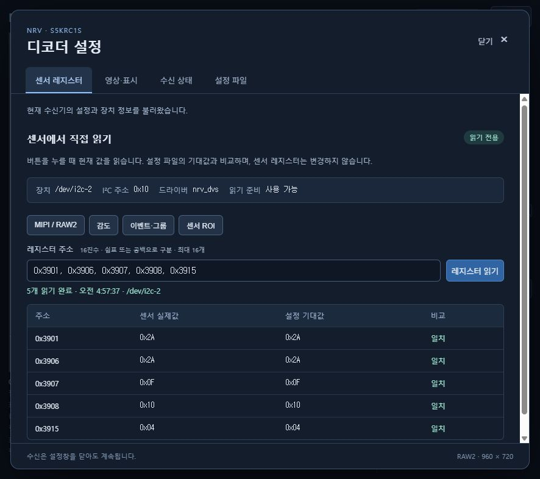
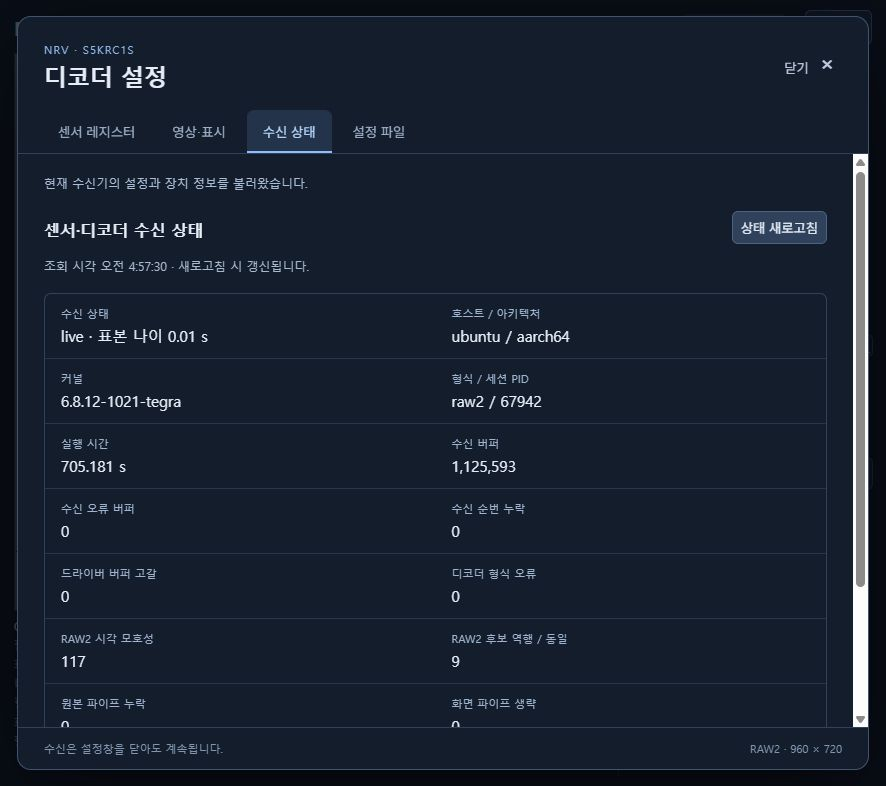

# Jetson .121 디코더 설정창 적용 기록 — 2026-11-02

## 적용 결과

Orin Nano Super / R39.2.1 / 커널 `6.8.12-1021-tegra`에 설정창을 적용했다.
`http://192.168.0.121:8080/`의 **설정** 버튼으로 연다.
코드와 [사용 가이드](../guides/VIEWER-SETTINGS.md), 아래 검증 로그를 함께 기록한다.

- 센서 레지스터: 실제 I2C 읽기, 주소 모음·직접 입력, 설정 기대값 비교
- 영상·표시: 극성, 좌우·상하 반전, 노이즈 제거, 프리뷰, 표시 ROI, 일시정지, PNG
- 수신 상태: 커널·형식·세션, 수신·디코더 카운터
- 설정 파일: 현재 실행 setfile 스냅샷, SHA-256, 순서·주석·검색

V920 전용 소스는 확인하지 못했다. 사용자 제공 V920 서비스 주소 `.110:8080`는
확인 시 연결 시간 초과였다. 확보된 RP5 설정창과 기존 Orin 센서 도구를 참고·재사용한
범위와 고정 커밋은 [출처 기록](../guides/VIEWER-SETTINGS.md#재사용-출처)에 명시했다.

## 실행 과정

PC에서 기존 Git 인증으로 main을 확인했다(`5630fb9`). Jetson에는 Git 인증정보를
복사하지 않고 Git bundle로 이전 가이드 이력을 fast-forward했다. 작업 전 양쪽
저장소의 상태를 확인했으며 Jetson 소스는 깨끗했다. 변경 파일은 SSH/SCP로 전달했고
전송 패키지 SHA-256이 일치함을 확인했다.

```text
1f890123385cb38d4479ccc1764e3296018e67ebf236ee5d808e6319d757f369
```

기존 소스 백업은 Jetson의
`build/logs/settings-20261102/previous-source.tar.gz`에 보존했다.
녹화 상태 `idle`을 확인한 뒤 다음을 실행했다.

```bash
python3 -m unittest discover -s tests -p test_sensor_settings.py -v
python3 -m py_compile app/dvs_streamer/python/{sensor_settings,viewer,run}.py
./dvs stop
cmake --build app/dvs_streamer/output/GCC-arm64 --config Release --target dvs_streamer_runtime
./dvs start
python3 tests/check-settings-api.py --read
sha256sum -c build/logs/settings-20261102/binaries-before.sha256
```

Python/web 실행 파일 복사 대상만 빌드했다. 새 Python 파일 추가로 CMake가 자동 재구성되었고
runtime target은 성공했다. `nrv_dvs.ko`, `cam1.dtbo`, `dvs_streamer`의 SHA-256은 전후 동일했다.
커널·부팅 설정 변경이나 재부팅은 없었다. 새 capture PID는 `67942`, viewer PID는 `67943`이다.

## 검증 증거

[로그 폴더](evidence/2026-11-02/)에 원본 결과가 있다. HTTP 토큰은 기록에서 제거했다.

- PC와 Jetson에서 Python 단위 테스트 **8/8 통과**: 파서 일치, 주소/개수 검증,
  I2C 메시지 구조, 부분 전송 오류, 파일 디스크립터 정리, 동시 접근·주기 제한.
- JavaScript 두 파일의 `node --check` 통과.
- 실행 중 HTTP 검사 **12개 통과**: 토큰·잘못된 Host/Origin 거부, 비ASCII 토큰,
  음수·초과·boolean 주소, 17개 요청, 잘못된 필드·형태, 실제 읽기, 연속 읽기 429.
- 실제 MIPI 레지스터 5개가 모두 설정값과 일치했다.

| 주소 | 실제값 | 설정값 |
|---|---|---|
| 0x3901 | 0x2A | 0x2A |
| 0x3906 | 0x2A | 0x2A |
| 0x3907 | 0x0F | 0x0F |
| 0x3908 | 0x10 | 0x10 |
| 0x3915 | 0x04 | 0x04 |

브라우저에서도 읽기 버튼으로 같은 값을 확인했다. 이벤트·그룹 메뉴는 `0x392C=0x08`
(Merged Group=1), `0x3282=0x00`을 반환했다. `0x3282`는 setfile에 없으므로
`비교값 없음`으로 표시했다. 표시 ROI `X 100–800`, ON만 표시, 좌우 반전과 일시정지를
적용하고 PNG 다운로드를 확인했다. 검증 뒤 표시 설정을 기본값으로 복구했다.
설정 파일에서 `3907` 검색 시 원본 52행의 `0x0F`와 주석이 표시되었다.



업데이트 후 **732.921초** 표본:

- 프레임 `1,171,069`, 수신 버퍼 `1,169,871`
- 수신 오류 버퍼 `0`, 수신 순번 누락 `0`, 버퍼 고갈 `0`
- 녹화 `idle`, 정상 수신 `live`
- RAW2 시각 모호성 `122`, 후보 역행/동일 `9`



이 수신 관찰은 약 12분의 기능 검증이다. RAW2 시각 후보 문제는 기존 제한으로 남아 있으며,
장시간·고부하 안정성 전체를 보증하지 않는다. 시작 로그의 `RLIMIT_RTPRIO < 10` 경고대로
현재 일반 스케줄링으로 실행했으며 권한·스케줄러 설정을 변경하지 않았다.
센서 쓰기·프로파일 적용·Time Surface는 이번 버전의 제공 기능에 포함되지 않는다.
